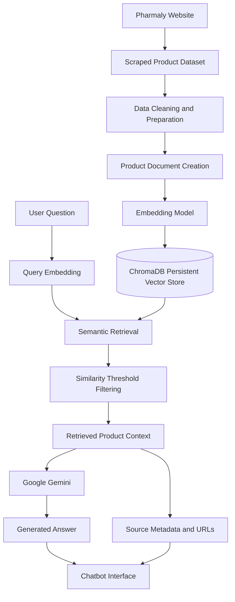

# Pharmaly Product Q&A Chatbot using Retrieval-Augmented Generation (RAG)

An AI-powered product information assistant for [Pharmaly](https://www.pharmaly-dz.com), an Algerian online pharmacy and parapharmacy.

The chatbot retrieves relevant products, generates answers using Gemini, and provides links to the product pages used as sources. If the requested information is unavailable, it communicates that instead of inventing an answer.

---

## Table of Contents

1. [Project Objectives](#1-project-objectives)
2. [Dataset and Data Preparation](#2-dataset-and-data-preparation)
3. [System Architecture](#3-system-architecture)
4. [RAG Pipeline](#4-rag-pipeline)
5. [Technical Stack](#5-technical-stack)
6. [Installation and Configuration](#6-installation-and-configuration)
7. [Running the Project](#7-running-the-project)
8. [Demonstration](#8-demonstration)
9. [Evaluation and Testing](#9-evaluation-and-testing)
10. [Project Structure](#10-project-structure)
11. [Team Contributions](#11-team-contributions)
12. [Limitations and Future Improvements](#12-limitations-and-future-improvements)

---

## 1. Project Objectives

The main objective is to develop a conversational assistant capable of retrieving and explaining product information from the Pharmaly catalogue.

The specific objectives are:

1. **Prepare a structured product knowledge base:** transform scraped product information into a format suitable for semantic retrieval.
2. **Implement semantic search:** retrieve products based on the meaning of a user's question rather than exact keyword matching alone.
3. **Integrate a vector database:** store product documents, embeddings, and source metadata in ChromaDB.
4. **Generate grounded answers:** use Gemini to formulate natural-language responses based on retrieved product information.
5. **Provide source traceability:** display the original product names and URLs used to generate answers.
6. **Handle unsupported questions:** avoid generating answers when the requested information is unavailable or outside the product catalogue.
7. **Support conversational interactions:** maintain recent conversation history to handle follow-up questions.

## 2. Dataset and Data Preparation

### 2.1 Data source

The project uses product information collected from the Pharmaly website through the web-scraping work developed in Challenge 1.

### 2.2 Relevant product attributes

The following fields are used by the RAG implementation:

| Field | Description | Purpose |
|---|---|---|
| `product_name` | Product name | Identifies the product |
| `brand` | Product brand | Provides brand information |
| `categories` | Product category | Helps describe product type |
| `current_price` | Current listed price | Provides price information |
| `description` | Product description | Supplies semantic information for retrieval and answer generation |
| `product_url` | Original product page URL | Enables source attribution |

### 2.3 Data preparation

Before indexing, the product dataset is cleaned to improve the quality of the knowledge base.

The preparation process includes:

- Loading the processed CSV dataset.
- Removing records without a product name, description, or source URL.
- Excluding products with descriptions shorter than the configured minimum length.
- Removing duplicate products based on their product URLs.
- Handling missing or empty values with default labels.
- Preparing a textual representation of each product.

### 2.4 Document representation

Each product is represented as one document containing its relevant attributes.

The project uses **one product per document** rather than splitting product descriptions into multiple smaller chunks. This keeps the product's name, brand, category, price, and description together during retrieval.

The original product URL and other metadata are stored separately in ChromaDB so that retrieved results can be traced back to their source pages.

## 3. System Architecture

The application follows a Retrieval-Augmented Generation architecture.

The system is divided into two main stages:

- **Knowledge base construction:** preparing product documents, generating embeddings, and storing them in ChromaDB.
- **Question answering:** processing user questions, retrieving relevant products, and generating answers using Gemini.

### 3.1 Architecture overview



### 3.2 Main components

| Component | Responsibility | Implementation |
|---|---|---|
| Data preparation | Cleans and structures scraped product information | Processed CSV and indexing preparation |
| Embedding model | Converts product documents and user questions into vectors | Sentence Transformers |
| Vector database | Stores product documents, embeddings, and metadata | ChromaDB |
| Retrieval engine | Finds semantically relevant products | ChromaDB similarity search |
| Filtering mechanism | Removes results below the configured similarity threshold | Similarity threshold |
| Language model | Generates answers using retrieved context | Google Gemini |
| Chatbot interface | Handles user questions and displays answers and sources | Jupyter Notebook interface |

## 4. RAG Pipeline

This section describes how the implemented system works, from initial indexing to answer generation.

### 4.1 Knowledge base construction

The knowledge base is built before the chatbot is used.

**Step 1 Load and clean the dataset**

The system loads the processed product CSV and removes incomplete, insufficiently described, and duplicated records.

**Step 2 Create product documents**

Each remaining product is transformed into a textual document containing its name, brand, category, price, and description.

**Step 3 Generate embeddings**

The project uses the following Sentence Transformers model:

`paraphrase-multilingual-MiniLM-L12-v2`

The embedding model converts each product document into a numerical vector representing its semantic content.

Embeddings are normalized before being stored.

**Step 4 Store information in ChromaDB**

The generated vectors, textual documents, and product metadata are stored in a persistent ChromaDB collection.

The collection uses cosine similarity as its distance metric.

Product metadata includes the product name, brand, category, current price, and original product URL.

**Step 5 Persistent indexing**

The vector database is stored locally in `rag/chroma_db/`.

The indexing script checks whether the collection already exists. If it does, the script skips rebuilding it unless the `--rebuild` option is explicitly supplied.

This avoids unnecessarily regenerating embeddings every time the chatbot starts.

### 4.2 User query processing and retrieval

When a user submits a question, the system performs the following operations:

1. Receives the question from the chatbot interface.
2. Uses the same embedding model to convert the question into a vector.
3. Queries ChromaDB using semantic similarity.
4. Retrieves the five most relevant product documents (`TOP_K = 5`).
5. Calculates similarity scores from the returned cosine distances.
6. Filters out products whose similarity scores are below the configured threshold.

The remaining products are considered relevant candidates for answer generation.

### 4.3 Similarity threshold

Retrieving the nearest documents does not necessarily mean that they are relevant to the user's question.

For this reason, the project uses a similarity threshold to filter weak matches.

The threshold is configurable through the `SIMILARITY_THRESHOLD` environment variable.

A calibration script compares the similarity scores of example in-scope and out-of-scope questions. It helps identify a reasonable threshold based on the observed score distributions rather than selecting an arbitrary value.

### 4.4 Answer generation with Gemini

Once relevant products have been retrieved, their information is assembled into a context and passed to Google Gemini.

The project uses the `google-genai` library to communicate with the Gemini API.

The system prompt instructs the model to:

- Answer using only the retrieved product information.
- Avoid inventing product names, prices, ingredients, brands, or properties.
- Include all relevant retrieved products when the user requests multiple products.
- Identify information that is missing from the retrieved context.
- Follow the language of the user's latest question.
- Return structured JSON containing the generated answer and the identifiers of the products used.

The generated answer is therefore based on the retrieved product context rather than unrestricted model knowledge.

### 4.5 Refusal mechanism

The system includes two levels of protection against unsupported answers.

**Retrieval-level filtering**

If no retrieved product meets the configured similarity threshold, the system returns a predefined message:

> Sorry, I couldn't find this information in the Pharmaly product database.

**Generation-level validation**

If Gemini indicates that the retrieved information does not contain the answer, the system returns the same refusal message instead of presenting an unsupported response.

This mechanism is particularly important for questions unrelated to the Pharmaly catalogue.

### 4.6 Source attribution

Source attribution is handled by the application rather than relying on URLs generated by the language model.

Each retrieved product contains metadata with its original product name and URL.

After generation, the application uses the product identifiers returned by Gemini to select the corresponding retrieved products and display their original source URLs.

### 4.7 Conversation history and follow-up questions

The chatbot maintains a limited conversation history containing the last three exchanges.

This allows users to ask follow-up questions without repeating the entire context.

Before retrieval, the system uses Gemini to rewrite a follow-up question into a standalone question when necessary.

The rewritten question is then processed by the normal retrieval pipeline.

## 5. Technical Stack

| Technology | Role |
|---|---|
| Python | Main programming language |
| Pandas | Dataset loading and preparation |
| Sentence Transformers | Text embedding generation |
| `paraphrase-multilingual-MiniLM-L12-v2` | Embedding model |
| ChromaDB | Persistent vector database |
| Google Gemini | Context-based answer generation and follow-up question rewriting |
| `google-genai` | Gemini API integration |
| python-dotenv | Environment variable management |
| Jupyter Notebook | Interactive chatbot interface and experimentation |
| Git and GitHub | Version control and collaboration |

## 6. Installation and Configuration

### 6.1 Prerequisites

- Python 3.12
- Git
- A Google Gemini API key
- Access to the project repository

### 6.2 Clone the repository

```bash
git clone https://github.com/meema29/RAG-.git
cd RAG-
```

### 6.3 Create a virtual environment

Windows PowerShell:

```powershell
py -3.12 -m venv .venv
.\.venv\Scripts\Activate.ps1
```

Linux / macOS:

```bash
python3 -m venv .venv
source .venv/bin/activate
```

### 6.4 Install dependencies

```bash
pip install -r requirements.txt
```

### 6.5 Configure environment variables

Create a `.env` file in the project root directory.

Add the following variables:

```env
GEMINI_API_KEY=your_gemini_api_key
GEMINI_MODEL=gemini-3.5-flash
SIMILARITY_THRESHOLD=0.58
```

The model and threshold values above are examples of the project's configuration. The code also provides defaults if optional variables are not defined.

Obtain a Gemini API key from [Google AI Studio](https://aistudio.google.com).

**Security note:** Never commit `.env` or expose your API key. The `.env` file is excluded through `.gitignore`.

## 7. Running the Project

### 7.1 Build the vector index

From the project root, execute:

```bash
py -3.12 -m rag.build_index
```

The script loads the processed dataset, generates embeddings, and stores the products in the persistent ChromaDB collection.

If the index already exists, it skips the indexing process.

To rebuild the index:

```bash
py -3.12 -m rag.build_index --rebuild
```

The vector database is generated locally and is not included in the Git repository.

### 7.2 Launch the chatbot

Open:

`rag/chatbot.ipynb`

Use Jupyter Notebook or the Jupyter extension in Visual Studio Code.

Execute the notebook cells in order to initialize the chatbot and start the interactive question-and-answer loop.

Type `exit` to end the conversation.

### 7.3 Run similarity calibration

To inspect the similarity scores of relevant and irrelevant questions, execute:

```bash
py -3.12 -m rag.calibrate
```

The script displays the scores for predefined in-scope and out-of-scope questions and identifies the observed score separation.

Use the results to help select a suitable `SIMILARITY_THRESHOLD` value in `.env`.

This calibration script does not require a Gemini API key.

## 8. Demonstration

The `demo/` directory contains example questions and recorded chatbot responses.

The demonstration covers several important behaviors of the system.

For the complete examples and recorded outputs, see:

- `demo/qsts.md`  demonstration questions.
- `demo/answers.md`  example chatbot interactions and source URLs.

## 9. Evaluation and Testing

The project evaluates the behavior of the RAG pipeline through example questions covering both relevant and irrelevant topics.

The calibration script separates questions into two categories:

**In-scope questions**

Questions related to products available in the Pharmaly catalogue, such as ingredients, product categories, prices, and suitability described in the product information.

**Out-of-scope questions**

Questions unrelated to the available product data, such as general knowledge, unrelated products, or other topics.

The evaluation focuses on:

- Whether relevant products are retrieved.
- Whether irrelevant results are filtered.
- Whether the chatbot uses the retrieved information.
- Whether answers include the correct source URLs.
- Whether unsupported questions trigger a refusal.
- Whether follow-up questions are understood using conversation history.

The calibration results are used to guide the similarity threshold configuration.

## 10. Project Structure

```text
RAG-/
│
├── data/
│   ├── raw/
│   │   └── pharmaly_products_full.csv
│   │
│   └── processed/
│       └── pharmaly_products_rag_ready.csv
│
├── demo/
│   ├── qsts.md
│   └── answers.md
│
├── rag/
│   ├── chroma_db/             # Generated persistent vector database
│   │
│   ├── build_index.py         # Data preparation, embedding and indexing
│   ├── calibrate.py           # Similarity threshold calibration
│   ├── config.py              # Central project configuration
│   ├── rag.py                 # Retrieval, generation and conversation logic
│   ├── chatbot.ipynb          # Interactive chatbot
│   │
│   ├── data inspection.ipynb  # Dataset exploration
│   ├── embedding.ipynb        # Embedding experimentation
│   ├── query_processor.ipynb  # Query processing exploration
│   ├── retriever.ipynb        # Retrieval experimentation
│   ├── llm.ipynb              # LLM experimentation
│   ├── prompt.ipynb           # Prompt engineering experimentation
│   └── rag_pipeline.ipynb     # Earlier pipeline experimentation
│
├── .env                       # Local API configuration (not committed)
├── .gitignore
├── README.md
└── requirements.txt
```

The Python scripts implement the final pipeline. The additional notebooks document the development and experimentation process and can be used as supporting technical material.

## 11. Team Contributions

The project was developed collaboratively, with responsibilities divided across four main technical areas.

| Member | Area | Main contribution |
|---|---|---|
| Meriem Hamzaoui | Data preparation and coordination | Dataset inspection, cleaning, document preparation, source metadata preservation, and end-to-end integration |
| Ahlem Khaloua | Embeddings and vector database | Embedding model selection, vector generation, ChromaDB configuration, and persistent indexing |
| Rahima Hamouda | Retrieval and source citations | Query processing, semantic search, similarity filtering, threshold calibration, and retrieval evaluation |
| Nesrine Oulhadj | LLM and chatbot | Gemini integration, prompt engineering, context-grounded generation, refusal behavior, conversation handling, and chatbot interface |

The final implementation brings these components together in a single RAG pipeline.

## 12. Limitations and Future Improvements

### Current limitations

- **Data dependency:** The chatbot's knowledge is limited to the information available in the scraped Pharmaly dataset.
- **Retrieval quality:** Semantic retrieval depends on the embedding model, product descriptions, and similarity threshold.
- **Incomplete descriptions:** Missing or insufficient product information can reduce the quality of retrieved results.
- **LLM dependency:** Answer generation and follow-up question rewriting require access to the Gemini API.
- **Threshold trade-off:** A threshold that is too high may reject relevant products, while a threshold that is too low may retain irrelevant results.
- **No live catalogue synchronization:** The local knowledge base must be rebuilt when the source dataset is updated.
---

**Project:** Pharmaly RAG Chatbot  
**Repository:** https://github.com/meema29/RAG-  
**Product data source:** https://www.pharmaly-dz.com
